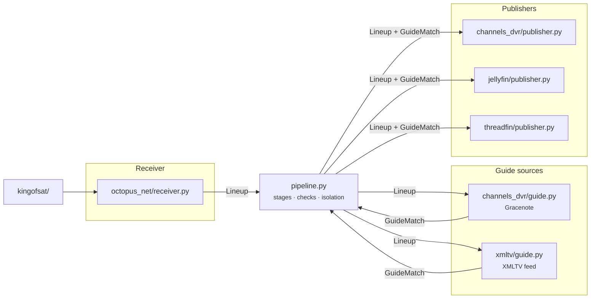
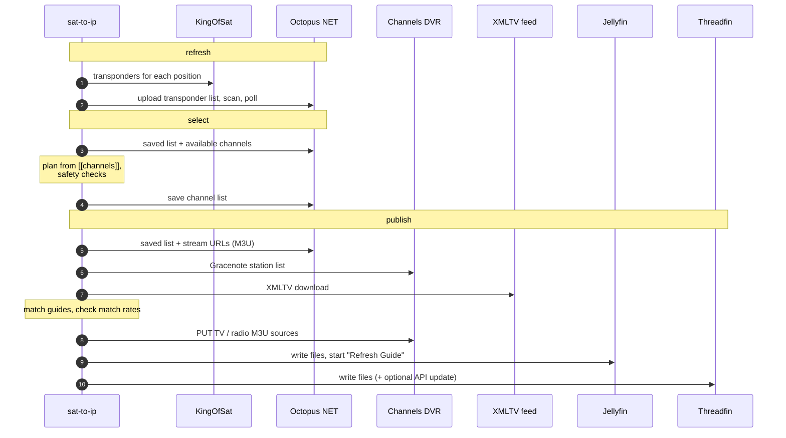

# Contributing

Thanks for helping. The most useful contributions are usually small:

- **A channel that won't match its guide:** add a line to the right mapping table (see [Guide mappings](#guide-mappings)).
- **Another receiver, guide source or app:** one new module plus its tests (see [Adding a receiver, guide or app](#adding-a-receiver-guide-or-app)).

The design notes are in [docs/design/multi-dvr.md](docs/design/multi-dvr.md).

## Getting set up

```bash
git clone https://github.com/Matt-Hadley/sat_to_ip_helpers && cd sat_to_ip_helpers
python3 -m venv .venv && . .venv/bin/activate
pip install -e ".[dev]"
```

Before you push, run the same checks CI runs (on Python 3.11 and 3.15):

```bash
black --check . && isort --check-only . && ruff check . && mypy && pytest --cov
```

`mypy` runs in strict mode, and coverage must stay at or above 95% (it is at 100%).

## How it fits together

There are three kinds of part, and they only meet through the data model. [`pipeline.py`](sat_to_ip/pipeline.py) is the one module that knows how they connect; [`registry.py`](sat_to_ip/registry.py) is the one place that names them.



| Part | Interface in [`interfaces.py`](sat_to_ip/interfaces.py) | Built in |
|---|---|---|
| Receiver | `Receiver`, optionally `SupportsRefresh` (rescan) and `SupportsSelection` (a saved channel list) | `octopus_net` |
| Guide source | `GuideSource`, with a `kind`: `gracenote` or `xmltv` | `gracenote`, `xmltv` |
| Publisher | `Publisher`, declaring the guide kinds it accepts | `channels_dvr`, `jellyfin`, `threadfin` |

The data passed between them is in [`model.py`](sat_to_ip/model.py):

- `Lineup`: the receiver's channels, in order.
- `GuideMatch`: a guide reference per channel `key`, the unmatched channels, and for XMLTV the guide filtered to the matched channels.
- `SelectionPlan`: the current and proposed channel lists.

Every type is frozen.

### A run in time order



### The rules the pipeline enforces

- **refresh** or **select** failing aborts the run, because the receiver's state is then uncertain.
- In **publish**, a failing guide source (or one below `min_guide_match`) fails only the publishers that use it. Each publisher is isolated from the others.
- Nothing is kept between runs: every stage reads live from the receiver.
- **Dry run:** no refresh, no saves, no write API calls, no files written. Everything is still built and checked, and read-only calls (e.g. finding the Channels DVR sources or Jellyfin's task) still run.
- **Exit codes:** `0` all ok, `1` anything failed, `2` config or usage error.

## Project layout

```
sat_to_ip/
  cli.py          the sat-to-ip command
  config.py       TOML loading; Section validates each key and names it in errors
  registry.py     config "type" → builder (lazy imports)
  pipeline.py     stages, checks, failure isolation, RunReport
  checks.py       the safety checks
  model.py        Channel, Lineup, GuideRef, GuideMatch, SelectionPlan, PublishResult
  interfaces.py   the Protocols
  m3u.py          parse / render M3U (values are cleaned: guide data is untrusted)
  file_output.py  tv.m3u / radio.m3u / guide.xml for file-reading apps
  files.py        atomic writes
  http.py         sessions with timeouts; retries for GET/HEAD only
  mappings.py     Name,GuideId tables
  selection.py    channel lists: parsing, matching (Name, Name@MHz, tv/radio/all), channel numbers
  channel_picker.py  the interactive (curses) channel picker, for any receiver
  channel_setup.py   `sat-to-ip channels`: picker → [[channels]] blocks written into the config (tomlkit)
  octopus_net/    receiver, client, transponders, scan diff
  kingofsat/      transponder scraper
  channels_dvr/   client, Gracenote guide, publisher
  xmltv/          XMLTV guide (streaming parse, size caps)
  jellyfin/       publisher
  threadfin/      publisher
  data/mappings/  <guide kind>/<region>/{tv,radio}.csv
tests/            one file per module; fakes.py and contracts.py are shared
examples/         example config and channel list; sample Gracenote station lists
docs/             design notes and per-app setup guides
```

## Adding a receiver, guide or app

### A receiver from another manufacturer

A receiver only talks to the box. Matching the channel list, the interactive picker, channel numbers and every safety check are done for it by the core, so they work the same for every box.

| Method | Required? | What it does |
|---|---|---|
| `lineup() -> Lineup` | yes | The saved channels in order, each a `Channel` with a stable `key` (e.g. `"mybox:<service id>"`), name, `kind` (`"tv"`/`"radio"`), stream URL and, if known, frequency. Leave `number` at 0: the pipeline numbers the lineup. |
| `refresh()` | no | Update the box's transponder list and rescan. [`kingofsat/`](sat_to_ip/kingofsat/) fetches transponder lists for any satellite position, if your box needs one. |
| `selection_candidates() -> (saved, found)` | no, with `save_selection` | The channels the box has saved, and others it has found, as `ChannelRef`s (key, name, kind, frequency). |
| `save_selection(channels)` | no, with `selection_candidates` | Make exactly these the box's saved channels, in this order. |

Without the selection methods, the select stage is skipped and the lineup is whatever the box has saved. [`octopus_net/receiver.py`](sat_to_ip/octopus_net/receiver.py) is a complete example; `FakeReceiver` and `BasicReceiver` in [tests/fakes.py](tests/fakes.py) are the smallest ones.

### Any part

1. **Write the class.** Satisfy the matching `Protocol` in [`interfaces.py`](sat_to_ip/interfaces.py). The smallest working examples are in [tests/fakes.py](tests/fakes.py).
2. **Add a builder,** `def from_config(section: Section) -> YourClass`:
   - Read every setting through `Section` (`get_str`, `get_url`, `get_path`, `get_secret`, …). It checks types and names the key in errors.
   - Take secrets only via `*_env` keys.
   - Do **no network I/O** in the builder: `check-config` must work offline. Connect on first use.
3. **Register it** with one line in [`registry.py`](sat_to_ip/registry.py).
4. **Test it:**
   - Call `assert_guide_contract` / `assert_publisher_contract` from [tests/contracts.py](tests/contracts.py).
   - Stub HTTP with `MagicMock` sessions, as the existing tests do.
   - Run it through `pipeline.run` once with the fakes.
5. **Document it:** add a setup guide under `docs/setup/` and link it from the README.

Nothing else should need to change. If it does, the boundary is in the wrong place; open an issue first.

Conventions worth keeping:

- Writes are never retried. Anything that replaces a list (a DVR source, a playlist file, the receiver's channel list) must refuse to replace it with nothing.
- File writes go through `files.write_atomic`.
- External text that ends up in an M3U goes through `m3u.render`, which cleans it.

## Guide mappings

Channels are matched to guide entries by name. Where that fails, a table maps the channel name (as the receiver shows it) to the guide's ID:

```
sat_to_ip/data/mappings/<guide kind>/<table>/{tv,radio}.csv     header: Name,GuideId
```

- `gracenote/uk`: Gracenote call signs, used with Channels DVR.
- `xmltv/freeview-epg`: channel IDs from the [Freeview-EPG](https://github.com/dp247/Freeview-EPG) feed.

Only add national channels with a clear one-to-one match. Regional channels (ITV1, Channel 4 and their regions) belong in each user's own `extra_mappings` table.
