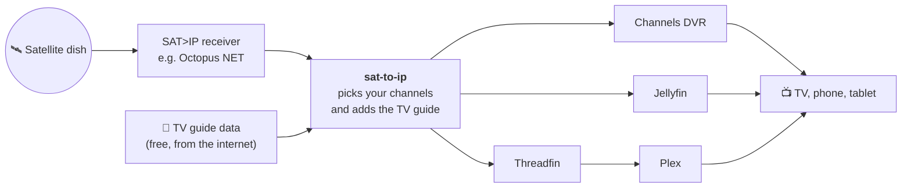

# sat-to-ip

Watch free satellite TV and radio in **Channels DVR**, **Jellyfin** or **Plex**, with a full TV guide, and keep the channel list up to date automatically.

It's for anyone with a satellite dish and a **SAT>IP receiver**: a box that turns the dish signal into streams on your home network. Out of the box it's set up for the UK free-to-air channels on Astra 28.2°E, the satellite Freesat uses.

**Supported receivers:** Digital Devices Octopus NET. Each receiver is a small plug-in, so support for other boxes can be added without touching the rest. See [CONTRIBUTING.md](CONTRIBUTING.md#a-receiver-from-another-manufacturer), or open an issue saying which box you have.



## What it does for you

Without it, getting satellite channels into a DVR app means doing a handful of fiddly steps by hand every time channels move: telling the receiver what to scan, picking channels, downloading a playlist, matching every channel to its guide listing, and loading it into each app.

`sat-to-ip` does all of that in one go:

1. **Rescans the satellite.** It fetches the current list of frequencies and has your receiver scan them, so moved channels are found again.
2. **Applies your channel list.** You keep a simple text file of the channels you want, in the order you want them.
3. **Adds the TV guide.** It matches each channel to its guide listing.
4. **Updates every app you use,** all from the same channel list.

Run it once, or let it run by itself once a week. If something looks wrong, for example the dish was covered in snow and the scan found half the usual channels, it stops and changes nothing (see [Keeping your channels safe](#keeping-your-channels-safe)).

## What you need

- A dish pointed at Astra 28.2°E and a supported SAT>IP receiver (today: the **Octopus NET**), with its admin password.
- A computer that's always on and can reach the receiver, e.g. the one that runs your DVR. macOS, Linux or Windows, with **Python 3.11 or newer**.
- At least one of:
  - **Channels DVR**
  - **Jellyfin** (free)
  - **Plex** with **Plex Pass**, plus **Threadfin** (free), because Plex can't read channel lists on its own

## Set it up

### 1. Install it

If you don't have [pipx](https://pipx.pypa.io/stable/installation/) yet, install it first (on a Mac: `brew install pipx`). Then:

```bash
pipx install git+https://github.com/Matt-Hadley/sat_to_ip_helpers
```

### 2. Get the two example files

Make a folder for your settings and download the example config and channel list into it:

```bash
mkdir ~/sat-to-ip && cd ~/sat-to-ip
curl -fsSLO https://raw.githubusercontent.com/Matt-Hadley/sat_to_ip_helpers/main/examples/sat-to-ip.toml
curl -fsSLO https://raw.githubusercontent.com/Matt-Hadley/sat_to_ip_helpers/main/examples/channels.txt
```

### 3. Choose your channels

Open `channels.txt`. It has one channel name per line, in the order you want them. Delete the ones you don't want, reorder freely, and use `#` for notes:

```
# TV
101 = BBC One HD
ITV1 HD
Channel 4 HD

# Radio
801 = BBC Radio 4
```

- **Names:** use them exactly as your receiver shows them. If the same name appears twice (e.g. two regions of a channel), add its frequency: `BBC One HD@10773`.
- **Several at once:** `all`, `tv` or `radio` take every channel of that kind you haven't already listed.
- **Channel numbers:** start a line with `<number> =` to set its number. The lines after it count up from there, so above ITV1 HD is 102 and Channel 4 HD is 103. Without any numbers, channels are numbered 1, 2, 3, … in list order. Numbers stay put: if a channel disappears from the satellite, its number is kept free and the others don't move.

### 4. Fill in the config

Open `sat-to-ip.toml`. Every setting has a comment; usually you only change these:

| Section | What to set |
|---|---|
| `[receiver]` | `host`: your receiver's address, e.g. `octopus.local` or `192.168.1.50` |
| `[[publishers]]` | Keep one block per app you use and delete the others. The [app guides](#5-prepare-your-apps) say what to put in each. |

Passwords never go in this file. The config only names a setting such as `OCTOPUS_PASSWORD`, and you set its value in your terminal:

```bash
export OCTOPUS_PASSWORD='your-receiver-password'
```

### 5. Prepare your apps

Each app needs a one-time setting so it knows where its channels come from:

- **Channels DVR:** [docs/setup/channels-dvr.md](docs/setup/channels-dvr.md)
- **Jellyfin:** [docs/setup/jellyfin.md](docs/setup/jellyfin.md)
- **Plex (through Threadfin):** [docs/setup/plex-threadfin.md](docs/setup/plex-threadfin.md)

### 6. Check, try, run

```bash
sat-to-ip check-config -c sat-to-ip.toml      # checks your settings, connects to nothing
sat-to-ip run -c sat-to-ip.toml --dry-run     # does everything except change anything
sat-to-ip run -c sat-to-ip.toml               # the real thing
```

At the end of every run there's a short summary with one line per step and per app:

```
  refresh                 ok
  select                  ok       76 channels (+2 / -0)
  publish:channels_dvr    ok       74 channels; tv: 65 → SatTV; radio: 9 → SatRadio
  publish:jellyfin        ok       76 channels; …
```

## Keeping your channels safe

The tool runs unattended, so it refuses to make a change that looks like a mistake. When that happens it changes nothing, shows the reason in the summary, and exits with an error so a scheduler can alert you.

| It won't… | …which protects you when |
|---|---|
| remove more than 5 of your saved channels in one go (you can change the 5 with `max_removed`) | rain or snow spoils the scan and fewer channels are found |
| save an empty channel list | your channel list doesn't match anything, e.g. after a typo |
| update an app from a guide that matches fewer than half the channels (`min_guide_match`) | the guide website is down or has changed |
| empty an app's TV or radio list | the guide matches the radio channels but none of the TV ones, or the other way round |

If one app can't be updated, the others still are.

After you've deliberately removed several channels from `channels.txt`, run once with `--allow-removals`.

## Run it automatically every week

Any scheduler works. On a Mac or Linux, `crontab -e` and add a line like this one (Sundays at 4am):

```
0 4 * * 0 cd ~/sat-to-ip && . ./secrets.env && ~/.local/bin/sat-to-ip run -c sat-to-ip.toml >> run.log 2>&1
```

Here `secrets.env` holds your `export OCTOPUS_PASSWORD=…` lines. Make it private with `chmod 600 secrets.env`.

The scan briefly takes over the receiver's tuners, so pick a time when nothing is recording. A GitHub Actions workflow on a self-hosted runner works too; keep your config and channel list in a private repo.

## Everyday commands

| I want to… | Command |
|---|---|
| run everything | `sat-to-ip run -c sat-to-ip.toml` |
| see what would happen, without changing anything | `sat-to-ip run -c sat-to-ip.toml --dry-run` |
| just resend the channels to my apps, no rescan | `sat-to-ip run -c sat-to-ip.toml --stages publish` |
| tick channels on and off in the terminal | `sat-to-ip run -c sat-to-ip.toml --interactive` |
| apply a channel list I've cut down on purpose | `sat-to-ip run -c sat-to-ip.toml --allow-removals` |
| check my settings | `sat-to-ip check-config -c sat-to-ip.toml` |
| see more detail | add `-v` before `run` |

## Troubleshooting

**"Config error: …"** The message names the exact setting, e.g. `publishers[1].output_dir: required` means the second `[[publishers]]` block is missing `output_dir`. Unknown settings are errors too, so a typo can't be silently ignored.

**A channel has no TV guide.** The run lists every channel without a guide match, and leaves it out of that app. Most channels match by name automatically. For the rest, make a small file such as `my-mappings.csv`:

```csv
Name,GuideId
ITV1 HD,ITV1Granada.uk
Channel 4 HD,Channel4North.uk
```

and point the guide at it with `mappings_file = "my-mappings.csv"`. `Name` is the channel name from `channels.txt`. `GuideId` is the guide's own ID for it, which you'll find in the guide file. ITV1 and Channel 4 come in regional versions, so these two lines are the usual ones to add, with your own region.

**Channel numbers changed.** Numbers only move when you change `channels.txt`. Set them explicitly with `<number> =` on the lines you care about (see [Choose your channels](#3-choose-your-channels)). In Channels DVR, also add `channel_numbers = "list"` to its publisher, otherwise Channels numbers the channels itself.

**"Refusing to remove N saved channels".** The scan found fewer channels than you have saved. Check the dish and try again later; if you really meant to drop them, run with `--allow-removals`.

**Jellyfin shows the old guide.** Jellyfin keeps a downloaded guide for up to an hour; it'll update on its next refresh.

**It ran but nothing changed.** Look at the summary: each line says `ok`, `failed` or `skipped`, with the reason. The command exits with `0` when everything worked, `1` when something failed, and `2` when the settings are wrong.

## Help and contributing

Found a channel that won't match, or want support for another receiver or app? Open an issue or a pull request. [CONTRIBUTING.md](CONTRIBUTING.md) explains how the code fits together and how to add things.

Guide data for Jellyfin and Plex comes from [Freeview-EPG](https://github.com/dp247/Freeview-EPG), a free community feed for personal use. Channels DVR uses its own Gracenote guide data.
