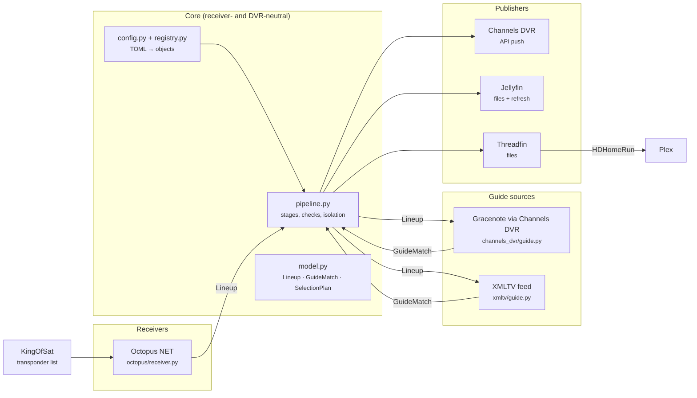
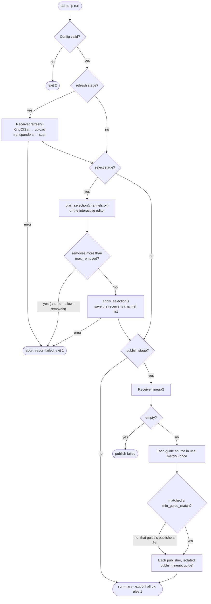
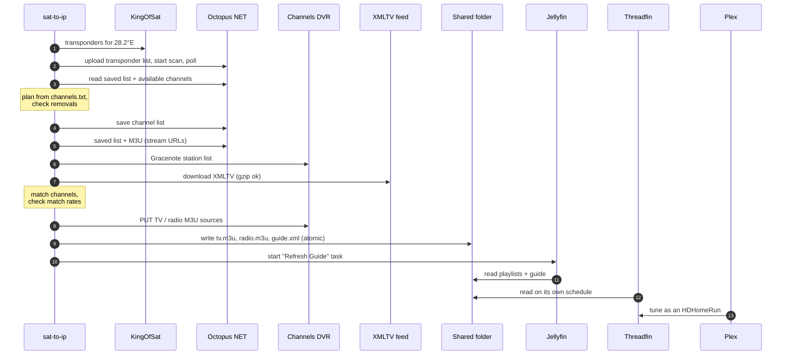
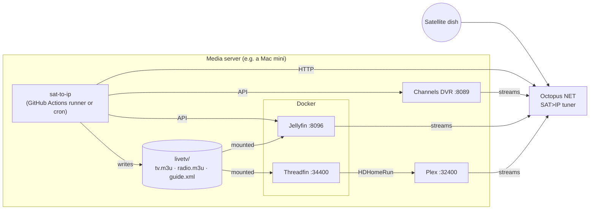
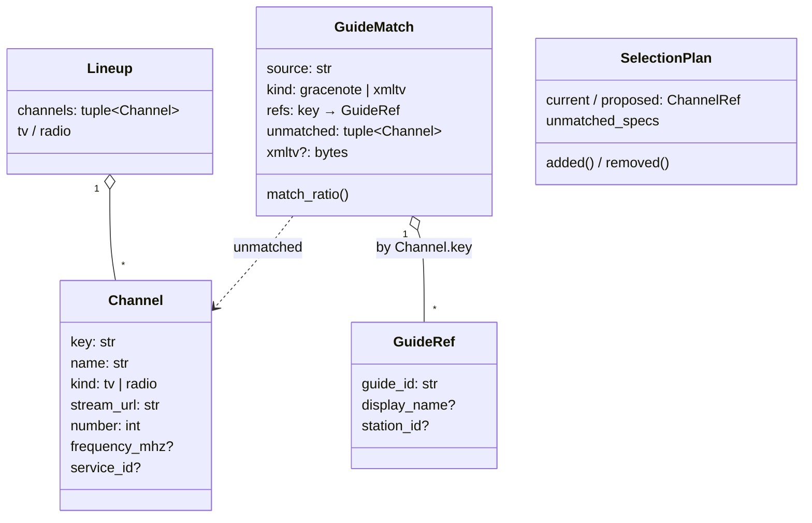

# sat_to_ip_helpers

Get free-to-air satellite channels from a SAT>IP receiver (a Digital Devices **Octopus NET**) into **Channels DVR**, **Jellyfin** and **Plex**, with programme guide data, from one unattended run.

One run rescans the satellite, applies your channel list, matches every channel to guide data, and publishes the same lineup to every DVR you configure. Safety checks stop a bad scan or a broken guide feed from wiping your channels.

```bash
pipx install git+https://github.com/Matt-Hadley/sat_to_ip_helpers
sat-to-ip run -c sat-to-ip.toml
```

---

## How it fits together

### Architecture

Three kinds of plug-in part, connected only by the data model. `pipeline.py` is the one module that knows how they connect.



Each part implements a small `Protocol` from [`interfaces.py`](sat_to_ip/interfaces.py) and is picked by the `type` key in the config through [`registry.py`](sat_to_ip/registry.py):

| Part | Interface | Built in |
|---|---|---|
| Receiver | `Receiver`, optionally `SupportsRefresh` (rescan) and `SupportsSelection` (saved channel list) | `octopus` |
| Guide source | `GuideSource` (`kind` = `gracenote` or `xmltv`) | `gracenote`, `xmltv` |
| Publisher | `Publisher` (declares which guide kinds it accepts) | `channels_dvr`, `jellyfin`, `threadfin` |

### A run, stage by stage



Every stage reads live data from the receiver, so nothing is stored between runs. `--stages publish` republishes whatever the receiver has saved now.

### A weekly run, in time order



### Deployment (one host)



### Data model



---

## Setup

Requirements: Python 3.11+, a SAT>IP receiver the pipeline supports (an Octopus NET), and at least one DVR.

```bash
pipx install git+https://github.com/Matt-Hadley/sat_to_ip_helpers
# or, from a clone, in a virtual environment:
pip install .            # add -e ".[dev]" to work on it
```

1. Copy [examples/sat-to-ip.toml](examples/sat-to-ip.toml) and [examples/channels.txt](examples/channels.txt) next to each other and edit them.
2. Set the secrets the config names, e.g. `export OCTOPUS_PASSWORD=…`.
3. `sat-to-ip check-config -c sat-to-ip.toml` validates everything without connecting.
4. `sat-to-ip run -c sat-to-ip.toml --dry-run` checks the receiver, guides and targets and changes nothing.
5. `sat-to-ip run -c sat-to-ip.toml`.

Per-DVR one-time setup:

- **Channels DVR:** add a custom M3U source per playlist (e.g. `OctopusTV`, `OctopusRadio`) and put their IDs in `tv_source` / `radio_source`. On a local network Channels DVR usually needs no login; if yours does, set `sid_env` to a variable holding the `SID` cookie from your browser.
- **Jellyfin:** see [docs/setup/jellyfin.md](docs/setup/jellyfin.md).
- **Plex (through Threadfin):** see [docs/setup/plex-threadfin.md](docs/setup/plex-threadfin.md). Plex Live TV needs Plex Pass.

## Configuration

[examples/sat-to-ip.toml](examples/sat-to-ip.toml) is a complete, commented example. The shape:

```toml
[receiver]                 # exactly one
type = "octopus"
host = "octopus.local"
password_env = "OCTOPUS_PASSWORD"

[selection]
channels = "channels.txt"  # relative to this file

[checks]
max_removed = 5            # refuse to drop more saved channels than this
min_guide_match = 0.5      # refuse a guide that matches less than half the channels

[guides.gracenote]         # named guide sources
type = "gracenote"

[guides.freeview]
type = "xmltv"
url = "https://…/epg.xml"

[[publishers]]             # one or more targets
type = "channels_dvr"
guide = "gracenote"
tv_source = "OctopusTV"
```

- Secrets are never in the file: any key ending in `_env` names the environment variable to read.
- Unknown keys are errors, so a typo fails loudly. Every error names the key, e.g. `publishers[1].output_dir: required`.
- A publisher only accepts guide kinds it can use: Channels DVR takes `gracenote`; Jellyfin and Threadfin take `xmltv`.

### The channel list

One entry per line; blank lines and `#` comments are ignored. The order is the channel order.

| Entry | Selects |
|---|---|
| `BBC One HD` | the first channel with that name |
| `BBC One HD@10773` | that name on that frequency (MHz), when a name appears more than once |
| `all` / `tv` / `radio` | every channel / every TV / every radio channel |

### Guide mappings

Most channels match their guide entry by name automatically. For the rest, built-in tables map a channel name to a guide ID: [sat_to_ip/data/mappings/](sat_to_ip/data/mappings/)`<guide kind>/<region>/{tv,radio}.csv`, with the header `Name,GuideId`. Pick a region with `mappings = "uk"`, and add your own with `mappings_file = "my-mappings.csv"` (your entries win). If a channel doesn't match, please add it to the right CSV and open a PR.

## Running it

```bash
sat-to-ip run -c sat-to-ip.toml                    # refresh, select, publish
sat-to-ip run -c sat-to-ip.toml --stages publish   # just republish what the receiver has
sat-to-ip run -c sat-to-ip.toml --interactive      # pick channels in the terminal
sat-to-ip run -c sat-to-ip.toml --allow-removals   # after deliberately trimming channels.txt
sat-to-ip run -c sat-to-ip.toml --dry-run          # check everything, change nothing
```

Exit codes: `0` everything succeeded, `1` something failed (the summary says what), `2` bad config or usage.

### Safety checks

| Check | Stops | When |
|---|---|---|
| `max_removed` | saving a channel list that drops more than N of the receiver's saved channels | a rainy or failed scan finds fewer channels |
| empty lineup | publishing nothing | the receiver lost its list |
| `min_guide_match` | publishing to targets that use a guide matching too few channels | the feed is down, empty or changed its IDs |
| empty source | Channels DVR: pushing an empty playlist over a source that had channels | |

One target failing never stops the others; the run still exits `1`.

### Run it on a schedule

Anything that can run a command works: cron, launchd, or a scheduled GitHub Actions workflow on a self-hosted runner that can reach your receiver. Run `sat-to-ip run -c /path/to/sat-to-ip.toml` and alert on a non-zero exit. Keep your config and channel list in your own (private) repo.

---

## Extending it

To add a receiver, guide source or DVR:

1. Write a class that satisfies the matching `Protocol` in [`interfaces.py`](sat_to_ip/interfaces.py). The smallest working examples are in [tests/fakes.py](tests/fakes.py).
2. Add `def from_config(section: Section) -> YourClass`. Read settings through `Section` (it validates types and names the key in errors). Do no network I/O there: connect on first use.
3. Add one line to [`registry.py`](sat_to_ip/registry.py).
4. Test it: call the shared checks in [tests/contracts.py](tests/contracts.py), stub HTTP with `MagicMock` sessions, and run it through `pipeline.run` once with the fakes.

Nothing else changes: the pipeline, the checks and the other integrations don't know your part exists.

## Development

```bash
pip install -e ".[dev]"
black --check . && isort --check-only . && ruff check . && mypy && pytest --cov
```

CI runs the same on Python 3.11 and 3.15. Coverage must stay at 95% or more; `mypy --strict` must pass. Design notes: [docs/design/multi-dvr.md](docs/design/multi-dvr.md).

```
sat_to_ip/
  cli.py  config.py  registry.py  pipeline.py  checks.py  model.py  interfaces.py
  m3u.py  files.py  http.py  names.py  mappings.py  selection.py  file_output.py
  octopus/        receiver, client, transponders, selection, dms_editor
  kingofsat/      transponder scraper
  channels_dvr/   client, Gracenote guide, publisher
  xmltv/          XMLTV guide
  jellyfin/       publisher
  threadfin/      publisher
  data/mappings/  Name,GuideId tables per guide kind and region
tests/            one file per module, plus fakes.py and contracts.py
examples/         example config and channel list; sample Gracenote station lists
docs/             design notes and per-DVR setup
```
